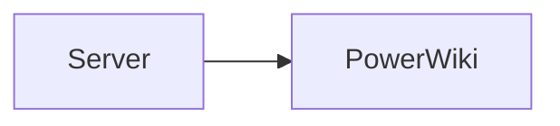

# Verifying PowerWiki on Azure DevOps Server

How to provision a disposable Azure DevOps Server project for PowerWiki's
browser canary checks. This is for Server only; Services uses the normal canary
process in `docs/browser-verification.md`.

## Server and extension setup

Use a non-production project with a project wiki. The signed-in account needs
permission to edit wiki pages, create work items and queries, and push changes
to the wiki repository (the smoke suite creates and removes pages and
attachments).

Install the private `powerwiki-canary` VSIX through the Server
extension-management UI. A locally packaged canary can use a fourth version
component while the public manifests stay unchanged:

```powershell
npm run build
npm run manifest:canary -- --build 3
npx tfx-cli extension create --manifest-globs vss-extension.canary.json
```

That produces `powerwiki-canary` version `1.10.0.3` when the public manifest is
`1.10.0`. This keeps Server validation private and separate from Marketplace
publishing.

Server URLs may have a collection and a virtual directory, for example:

```text
http://server/DefaultCollection/project/_apps/hub/dataversepowertools.powerwiki-canary.wiki
https://ado.example.test/tfs/Collection/project/_apps/hub/dataversepowertools.powerwiki-canary.wiki
```

Always pass the complete hub URL as `PW_HUB`. The harness derives the collection
base from that URL, preserving the Server hostname and virtual-directory path;
use `PW_COLLECTION_URL` only when the hub URL has a nonstandard shape.

## Required fixture data

Use a dedicated project wiki. The suite assumes these fixtures, so create them
before treating a content-specific failure as a product regression.

1. Create one ordinary work item (a Task is sufficient).
2. Create a saved shared query that returns that work item and note its query
   GUID.
3. Add `/.attachments/pw-size-probe.png`, a valid small PNG.
4. Create these wiki pages. Percent-encode spaces in Markdown link paths.

### `/Home`

Include a `#<work-item-id>` reference and a query-table block using the saved
query GUID. Keep the `PowerWiki Showcase` link percent-encoded.

```markdown
# Home

Work item: #123

::: query-table 00000000-0000-0000-0000-000000000000
:::

See [PowerWiki Showcase](/PowerWiki%20Showcase).
```

Add enough ordinary rendered content that editor, upload, and scroll-sensitive
checks have room to operate.

### `/PowerWiki Showcase`

This page must link to the two child pages and contain a Mermaid diagram. It
must be **scrollable**: the scroll-reset check scrolls this page, then navigates
to Home and expects the content scroll position to reset.

````markdown
# PowerWiki Showcase

See [Mermaid Gallery](/PowerWiki%20Showcase/Mermaid%20Gallery) and
[Math with KaTeX](/PowerWiki%20Showcase/Math%20with%20KaTeX).


````

Append enough headings and paragraphs to exceed the viewport height. Send real
Markdown line breaks and fence markers in API payloads; literal `\n` text does
not render as page structure.

### `/PowerWiki Showcase/Mermaid Gallery`

Include a `sequenceDiagram` fenced Mermaid block. The full suite uses it for
rendering, exports and navigation checks.

### `/PowerWiki Showcase/Math with KaTeX`

Include an inline `E = mc^2`, a `## Display` heading, and a display-math block
containing `E = mc^2`. The heading exercises absolute, shareable Server
permalinks.

## Running the suite

Edge is a useful independent Chromium build when Chrome has a profile lock or
crashes. Authenticate once, then run with the Server hub URL:

```powershell
$env:PW_CHANNEL = "msedge"
$env:PW_HUB = "http://server/DefaultCollection/project/_apps/hub/dataversepowertools.powerwiki-canary.wiki"
$env:PW_CODE_WIKI = "" # skip unless a CodeWikiTest fixture exists
npm run pw:auth
npm run pw:verify
```

The mention check is intentionally against a non-current-user project team.
Discover the local team's id and name, then configure the run rather than using
the Services fixture's `PowerWiki Team` identity:

```powershell
$env:PW_TEAM_ID = "<local-team-guid>"
$env:PW_TEAM_NAME = "<local team name>"
```

## Server-specific diagnostics

- Absolute heading and page links must begin with the Server collection and
  project path, not `dev.azure.com`. They must include `?route=` and preserve
  the route after a sign-in redirect.
- The Playwright request context does not currently carry Windows Integrated
  Authentication on Server. The app's upload flow is still valid when it passes,
  but the harness's attachment sweep/cleanup may report an authentication error.
  Delete only the named `/.attachments/pw-smoke-*` files afterwards, through an
  authenticated browser request or a commit to the test wiki repository.
- Treat a missing optional code wiki named `CodeWikiTest` as a skipped check.
  Add that fixture only when Code Wiki coverage is in scope.
- Treat 404s for deliberately missing optional fixture attachments as diagnostic
  noise unless the corresponding assertion fails.

When the full suite passes, record the exact Server URL shape, canary version,
browser, and configured team identity with the verification result.
